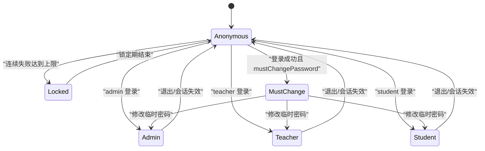
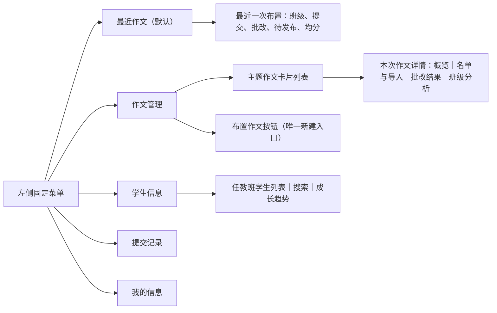
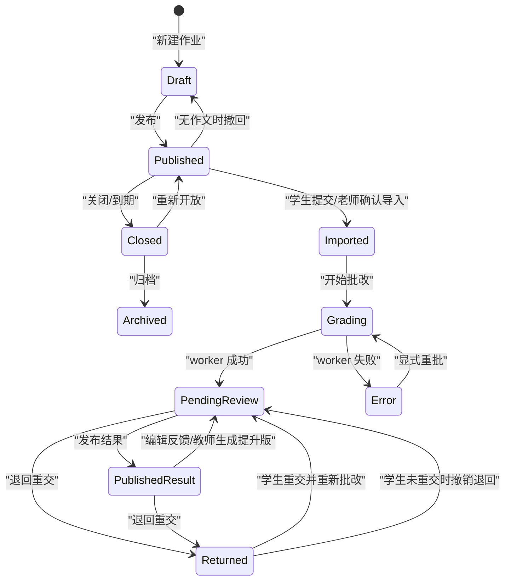
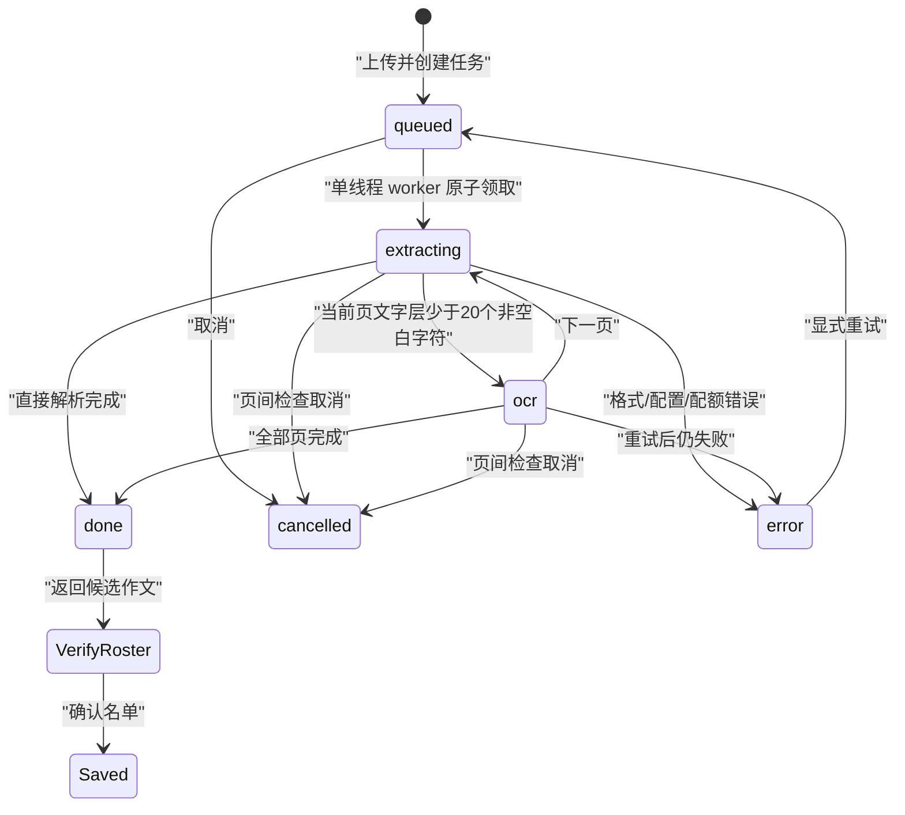

# 三端网页自动机、路由与跨账户影响

本文是网页行为的规范来源，覆盖管理员、教师、学生三端共 108 条实际路由。实现、测试和评审若与本文冲突，应先确认代码是否产生了未登记的新状态转移，再同步修改本文与契约测试。

## 1. 形式化定义

网页状态统一写为：

```text
S=(角色, 页面, 面板, 业务实体状态, 异步任务状态, 模块状态, 认证状态)
```

- 角色 `R∈{访客,admin,teacher,student}`。
- 页面 `P∈{登录页,管理员工作台,教师工作台,学生作业,自主练习,成长记录}`。
- 面板 `V` 是页面内 tab、列表、详情、弹窗或错误面板；教师作业详情固定为 `overview/import/results/analytics`。
- 业务实体状态 `E` 是账号、班级、作业、作文、发布快照、退回记录和学年的组合。
- 异步任务 `Jg∈{无,queued,running,done,error}` 表示批改；`Jo∈{无,queued,extracting,ocr,done,error,cancelled}` 表示智能导入。
- 模块 `M[k]∈{enabled,draining,disabled}`；核心认证、权限、存储、审计、调度与恢复恒为 `enabled`。
- 认证 `A∈{anonymous,authenticated,must_change,expired,locked}`。

状态转移函数为 `δ(S,event)=(S',effects,response)`。所有写转移必须同时满足角色权限、资源所有权、模块状态和实体状态守卫；否则实体不变，只转入可恢复失败状态。



临时密码唯一来源是 `DEFAULT_TEMP_PASSWORD=ChangeMe123!`。新建、Excel 导入和管理员重置都设置 `mustChangePassword=1`；改密前除认证和改密接口外返回 428。管理员重置、账号停用、转学、毕业及离线默认密码迁移会撤销该账号现有会话。学生名单导入只做本地规则检查，不向 AI 发送名单。

## 2. 页面与导航自动机

| 转移ID | 来源状态 | 按钮/选择器 | 事件 | 守卫 | HTTP方法与路由 | 服务端写入 | 其他用户可见变化 | 成功目标状态 | 失败目标状态 |
|---|---|---|---|---|---|---|---|---|---|
| NAV-01 | 访客,登录页 | `#login-form` | 提交登录 | 未锁定、凭据正确、账号有效 | `POST /api/login` | session、登录尝试 | 无 | 按角色落到 `/admin`、`/teacher` 或 `/student/assignments`；待改密先弹强制改密 | 原页错误；429 为锁定 |
| NAV-02 | 任意已认证页 | `#btn-logout` | 退出 | session 有效 | `POST /api/logout` | 删除当前 session | 无 | 登录页 | 网络失败也清本地 token 并回登录页 |
| NAV-03 | must_change | 强制改密弹窗 | 保存 | 原密码正确、新密码合规且不同 | `POST /api/account/password` | 独立哈希、清待改密、撤销其他会话 | 同账号其他窗口失效 | 角色落地页 | 弹窗内错误，不开放业务按钮 |
| NAV-04 | 任何 API 请求 | 无 | 收到 401 | token 缺失/过期/被撤销 | `GET /api/me` 等 | 无 | 无 | 清本地状态并跳登录页 | — |
| NAV-05 | 三端初始化 | 无 | 非 401 初始化失败 | 网络、500 或 503 | `GET /api/config`、`GET /api/features` | 无 | 无 | 可重试错误面板 | 点击“重新加载”重走初始化 |
| T-NAV-01 | 教师登录落地 | `#btn-dashboard` | 打开最近作文 | assignments 可用 | `GET /api/assignments`、`GET /api/assignments/<aid>` | 无 | 无 | 默认显示最近一次非草稿作文概况；无已发布作文则显示最近草稿/空状态 | 可重试错误面板 |
| T-NAV-02 | 教师工作台 | `#btn-students/#btn-assignments/#btn-records/#btn-profile` | 切换菜单 | 对应模块可用 | `GET /api/students`、`GET /api/assignments`、`GET /api/teacher/records`、`GET /api/me` | 无 | 无 | 学生信息/作文管理/提交记录/我的信息 | 可重试错误面板 |
| T-NAV-03 | 作文管理 | `.assignment-card` | 打开某次作文 | 当前教师是 `createdBy` | `GET /api/assignments/<aid>` | 无 | 无 | 同一作业保留 tab；新作业有活动批改进 results，否则 overview | 404 后回作文管理并提示 |
| T-NAV-04 | 教师作业详情 | `[data-detail-tab]` | 切换 tab | 对应模块可用 | 只读路由见第 8 节 | 无 | 无 | 目标 tab | 模块停用则入口隐藏 |
| A-NAV-01 | 管理员工作台 | 侧边导航 | 切换功能 | 对应模块可用 | 各管理员 GET 路由 | 无 | 无 | 原页目标工作区 | 可重试错误面板 |
| S-NAV-01 | 学生作业页 | `[data-assignment-view]` | 切换待完成/本班/历史 | assignments/academic_years 可用 | `GET /api/assignments`、`GET /api/student/assignments/archive` | 无 | 无 | 原页重绘列表 | 原页错误提示 |
| S-NAV-02 | 学生顶栏 | 作业/练习/成长记录链接 | 整页跳转 | 目标模块可用 | `GET /student/assignments`、`GET /student/practice`、`GET /student/history` | 无 | 无 | 目标页面 | disabled 时入口隐藏，直接请求由 API 守卫 |

### 2.1 教师端 UI 效果与信息架构



| 页面 | 首要信息 | 主按钮 | 点击后的可见后果 |
|---|---|---|---|
| 最近作文 | 最近一次非草稿作文概况 | 管理本次作文 | 进入该次作文详情；不写数据 |
| 学生信息 | 姓名、学号、班级、状态 | 成长趋势 | 只读查询该教师与学生相关的正式成绩 |
| 作文管理 | 每次主题、班级、状态、篇数、均分 | 布置作文/进入管理 | 创建草稿；或进入单次作文管理 |
| 提交记录 | 学生实际标题、关联作业、成绩、时间 | 详情/导出 | 打开反馈；或下载服务端命名 PDF |
| 我的信息 | 姓名、工号、学科、任教班级 | 修改密码 | 更新密码并撤销同账号其他会话 |

管理员侧边栏只显示实际功能按钮，不再显示“系统管理/运行管理”分组标题。编辑教师的任教班级时，候选项和已选项都按“年级自然序→班号自然序”排列（例如五年级1班在五年级10班之前）。

## 3. 教师端业务自动机

### 3.1 作业、批改、复核与发布



| 转移ID | 来源状态 | 按钮/选择器 | 事件 | 守卫 | HTTP方法与路由 | 服务端写入 | 其他用户可见变化 | 成功目标状态 | 失败目标状态 |
|---|---|---|---|---|---|---|---|---|---|
| T-ASG-01 | 作文管理 | `#btn-new-assignment` | 布置作文 | teacher、assignments enabled、任教班级有效 | `POST /api/assignments` | assignment=draft；记住本教师上次所选班级 | 学生不可见 | 新作业 overview | 400/403 原弹窗 |
| T-ASG-02 | overview | `#btn-publish` | 发布 | 所有者、draft | `POST /api/assignments/<aid>/publish` | lifecycle、publishedAt | 班内学生立即可见且可提交 | overview/published | 409 原状态 |
| T-ASG-03 | overview | `#btn-unpublish` | 撤回草稿 | published 且无作文 | `POST /api/assignments/<aid>/unpublish` | lifecycle=draft | 学生列表消失 | overview/draft | 409 原状态 |
| T-ASG-04 | overview | `#btn-close-assignment` | 关闭 | published | `POST /api/assignments/<aid>/close` | lifecycle=closed | 学生不能新提交，已发布结果仍在 | overview/closed | 409 原状态 |
| T-ASG-05 | overview | `#btn-reopen-assignment` | 重开 | closed、截止时间有效 | `POST /api/assignments/<aid>/reopen` | lifecycle=published、deadline | 学生重新可提交 | overview/published | 400/409 原弹窗 |
| T-ASG-06 | overview | `#btn-archive` | 归档 | closed、无活动任务 | `POST /api/assignments/<aid>/archive` | lifecycle=archived | 当前列表移除，历史快照保留 | archived 只读 | 409 原状态 |
| T-ASG-07 | import | `#btn-clear` | 清空 | draft、所有者 | `POST /api/assignments/<aid>/clear` | 删除作文、任务与版本关联 | 学生回到未提交 | import/空名单 | 409 原状态 |
| T-GRD-01 | results | `#bt-grade` | 批量批改 | 有 pending 作文、配额可用 | `POST /api/assignments/<aid>/grade` | grading_jobs queued、作文 queued | 学生端显示排队/批改中 | results+轮询 | 400/503 原页 |
| T-GRD-02 | results | `.regrade` | 单篇重批 | 非归档、配额可用 | `POST /api/assignments/<aid>/essays/<eid>/regrade` | 新 job、新 submission_version | 已发布旧快照不变 | results+轮询 | 404/409/503 |
| T-REV-01 | 结果详情 | `#fe-save` | 保存人工反馈 | feedbackVersion 未冲突 | `PUT /api/assignments/<aid>/essays/<eid>/feedback` | 当前反馈、版本号+1、pending_review | 已发布学生仍见旧快照 | results/待发布 | 409 要求刷新 |
| T-REV-02 | results | `.publish-result`/批量发布 | 发布结果 | 作业已发布、反馈完成 | `POST /api/assignments/<aid>/essays/<eid>/publish-result` 或 `POST /api/assignments/<aid>/publish-results` | published_feedback、不可变 history | 对应学生立即见结果 | results/published | 409 原状态 |
| T-REV-03 | 结果详情 | 生成提升版 | 教师生成 | 当前反馈版本未变、配额可用 | `POST /api/assignments/<aid>/essays/<eid>/upgrade` | 只改当前反馈、版本号+1、pending_review | 学生仍见旧发布快照 | results/待复核 | 409 冲突或 503 配额 |
| T-RET-01 | results | `.return-submission` | 退回 | 学生自交、结果可复核、无活动退回 | `POST /api/assignments/<aid>/essays/<eid>/return` | return、版本=returned、submission_open | 该学生见评语和重交通道 | returned | 409 原状态 |
| T-RET-02 | 版本弹窗 | `.cancel-return` | 撤销退回 | 活动退回且学生尚未重交 | `POST /api/assignments/<aid>/essays/<eid>/return/cancel` | cancelledAt、关闭重交、恢复版本状态 | 学生重交通道关闭 | 原版本状态 | 已重交返回 409，不回滚新稿 |

### 3.2 OCR/智能导入自动机



| 转移ID | 来源状态 | 按钮/选择器 | 事件 | 守卫 | HTTP方法与路由 | 服务端写入 | 其他用户可见变化 | 成功目标状态 | 失败目标状态 |
|---|---|---|---|---|---|---|---|---|---|
| T-OCR-01 | import/空闲 | `#dz,#file-input` | 上传 | 所有者、非归档、ocr enabled、配额未尽、≤60MB、PDF≤150页、允许格式 | `POST /api/assignments/<aid>/import-jobs` | staging、upload_token、ocr_job queued，并持久化 `splitMode=auto/one_page/two_pages` | 无 | import/进度面板 | 400/503 原上传区 |
| T-OCR-02 | 兼容调用方 | 旧智能导入 | 上传 | 同 T-OCR-01 | `POST /api/assignments/<aid>/ocr` | 与新接口相同 | 无 | 202 queued | 同上 |
| T-OCR-03 | import/活动任务 | 自动轮询 | 查询 | 创建者仍拥有作业 | `GET /api/assignments/<aid>/import-jobs/<job_id>` | 无 | 无 | 更新页数；done 进入名单核对 | 404 清本地任务引用 |
| T-OCR-04 | import/活动任务 | `#btn-import-cancel` | 取消 | queued/extracting/ocr | `POST /api/assignments/<aid>/import-jobs/<job_id>/cancel` | cancelRequested；最终 cancelled；清 staging/token | 无 | cancelled 后回上传区 | 409 保持终态 |
| T-OCR-05 | import/error | `#btn-import-retry` | 重试 | error、ocr enabled、配额可用 | `POST /api/assignments/<aid>/import-jobs/<job_id>/retry` | error→queued，仅错误页重排 | 无 | 继续进度 | 409/503 error 面板 |
| T-OCR-06 | import/名单核对 | `#can-save` | 确认 | 学生归属有效、标题≤120、无活动批改、令牌有效、单篇正文≤20000 | `POST /api/assignments/<aid>/essays` | 幂等 upsert、学生实际标题、来源指纹、提交版本、原件提升 | 绑定学生变为老师导入且锁定 | results/当前名单 | 409 保留候选供修正 |
| T-OCR-07 | import/名单核对 | `#can-cancel` | 放弃 | 令牌属于当前教师/作业 | `POST /api/assignments/<aid>/upload/cancel` | 清 staging/token | 无 | 上传区 | 过期也按成功处理 |

PDF 每页独立判断文字层；达到 20 个非空白字符直接提取，否则只渲染该页并串行调用 `ecnu-plus`。任务最多 60 MB / 150 页；`auto` 按姓名栏和跨页续文拆分，`one_page` 适配每页一篇作文纸，`two_pages` 适配正反面两页一篇。三种方式都先进入人工核对，不直接写作文。图片解码前执行 4000 万像素上限检查并缩放至最长边 2000 像素。超时、429、5xx 每页最多退避重试 2 次；已完成页在显式重试和进程重启后复用。OCR 使用独立单线程池，不占四线程批改池。模块停用时新任务返回 503；已有任务使模块先进入 `draining`，完成或取消后才成为 `disabled`。

## 4. 学生端自动机

| 转移ID | 来源状态 | 按钮/选择器 | 事件 | 守卫 | HTTP方法与路由 | 服务端写入 | 其他用户可见变化 | 成功目标状态 | 失败目标状态 |
|---|---|---|---|---|---|---|---|---|---|
| S-ASG-01 | 作业列表 | `.assignment-row` | 选择作业 | 班级成员、作业可见 | `GET /api/assignments` | 无 | 无 | 可提交卡/锁定说明/退回说明 | 原列表 |
| S-UP-01 | 作业或练习 | `#st-upload` | 解析文字文件 | student、imports enabled、单篇、≤20000 | `POST /api/student/parse` | 无 | 无 | 正文框填充 | 原页错误 |
| S-GRD-01 | 作业提交卡 | `#st-grade` | 提交 | published 或活动退回、未锁定、实际标题≤120、正文≤20000、配额可用 | `POST /api/student/grade` | 教师主题保持不变；`student_title` 保存学生实际标题；写 essay、submission_version、grading_job | 教师端出现 queued 作文及学生实际标题 | 锁定并轮询 | 403/409/503 原表单 |
| S-GRD-02 | 自主练习 | `#st-grade` | 提交 | practice/grading enabled、活动任务<3 | `POST /api/student/grade` | practice job | 教师端不可见 | 轮询 | 429/503 原表单 |
| S-GRD-03 | 活动任务 | 自动轮询 | 查询 | job 属于本人 | `GET /api/student/jobs/<job_id>` | 无 | 无 | 作业到等待发布；练习到结果 | 前端 15 分钟停止等待并提示；后台继续，刷新恢复 |
| S-HIS-01 | 成长记录 | 历史项 | 查看 | history 属于本人 | `GET /api/student/history` | 无 | 无 | 原页详情 | 404/错误提示 |
| S-HIS-02 | 历史详情 | 生成提升版 | 生成 | 本人记录、配额可用 | `POST /api/student/history/<hid>/upgrade` | `history_artifacts`，不改 history/result_json | 教师反馈与发布快照不变 | 原页展示派生稿 | 409 防重复/503 配额 |
| S-HIS-03 | 结果区 | `#st-export` | 下载 | 本人记录 | `GET /api/student/export/<hid>` | 临时 PDF | 无 | 保留服务端文件名下载 | 原页错误 |

## 5. 管理员端自动机

| 转移ID | 来源状态 | 按钮/选择器 | 事件 | 守卫 | HTTP方法与路由 | 服务端写入 | 其他用户可见变化 | 成功目标状态 | 失败目标状态 |
|---|---|---|---|---|---|---|---|---|---|
| A-USR-01 | 账号管理 | 新建/Excel确认 | 创建账号 | 编号唯一、密码合规、班级存在 | `POST /api/admin/users` 或导入确认 | 独立 PBKDF2 哈希、must_change | 新账号可用 `ChangeMe123!` 首登 | 原弹窗/预览错误 |
| A-USR-02 | 账号管理 | 重置密码 | 重置 | 非 admin 目标存在 | `POST /api/admin/users/<username>/reset-password` | 新独立哈希、撤销会话 | 目标立即掉线，需临时密码首登改密 | 原弹窗 |
| A-USR-03 | 学生管理 | 删除 | 无任何班级/作文/任务/版本/历史关联 | `DELETE /api/admin/users/<username>` | 备份后硬删 | 目标账号消失 | 原列表 | 409 引导转学/毕业/停用 |
| A-USR-04 | 学生管理 | 转学/毕业/恢复 | 状态切换 | 恢复时必须选活动班级 | `POST /api/admin/students/<username>/status` | 状态、成员关系、enrollment、会话 | 学生作业可见范围和登录状态改变 | 原列表 | 409 原状态 |
| A-CLS-01 | 班级管理 | 增删改/成员按钮 | 修改 | 活动学年、编号唯一；有作业禁删 | 班级写路由见第 8 节 | 定向 SQLite 事务 | 教师权限/学生作业范围变化 | 原工作区刷新 | 404/409 原状态 |
| A-YEAR-01 | 学年恢复 | 预演 | 计算 | 新学年晚于当前 | `POST /api/admin/academic-years/rollover/preview` | 无 | 无 | 确认弹窗 | 显示阻塞项 |
| A-YEAR-02 | 学年恢复 | 确认结转 | 结转 | 无草稿、活动批改、待发布结果；预览未漂移 | `POST /api/admin/academic-years/rollover/confirm` | 单事务归档旧年、复制学生和真实任课教师关系 | 全体旧作业冻结；毕业生停用 | 新学年工作区 | 409 全量回滚 |
| A-MOD-01 | 模块管理 | 启停开关 | 切换 | 依赖满足、非核心模块 | `POST /api/admin/modules/<module_key>/state` | feature_modules | 对应按钮/路由对所有用户变化 | enabled 或 draining/disabled | 409/400 原状态 |
| A-AI-01 | AI 设置 | 多模态测试 | 测试 | ecnu_plus 密钥存在 | `POST /api/admin/ai/profiles/<profile>/test` | ai_usage、audit | 无 | 显示真实多模态结果 | 400 显示分类建议 |
| A-REC-01 | 学年恢复 | 备份/预检/计划恢复 | 运维 | admin、备份有效 | 恢复写路由见第 8 节 | 备份或 pending restore | 恢复执行后影响全体数据和会话 | 原工作区/提示重启 | 409/500 不替换当前库 |

## 6. 跨账户影响矩阵

| 发起者动作 | 直接影响对象 | 其他端何时可见 | 不允许改变的内容 |
|---|---|---|---|
| 教师发布作业/关闭/归档 | 作业班级学生 | 下次列表请求立即可见 | 既有发布历史、版本链 |
| 教师确认绑定导入 | 被绑定学生 | 立即显示“老师已导入并锁定” | 其他来源的未绑定作文；重复来源不得追加副本 |
| 教师开始/重批 | 对应学生 | queued/running 状态立即可见 | 已发布历史快照 |
| 教师编辑反馈/生成提升版 | 对应作文 | 再次发布前学生仍见旧快照 | `published_feedback_json` 与旧 history |
| 教师发布结果 | 对应学生 | 立即出现成绩和成长记录 | 以前 publicationNo 的记录 |
| 教师退回/撤销退回 | 单个学生 | 立即开放/关闭重交通道 | 学生已重交时禁止撤销新稿 |
| 教师优秀作文发布 | 本班学生 | 作业优秀作文区 | 非本班学生不可见 |
| 管理员分班/任教关系 | 对应学生/教师 | 下次请求立即改变数据范围 | 历史学年 enrollment 与快照 |
| 管理员重置/停用账号 | 目标账号 | 当前会话立即失效 | 自定义密码账号不会被批量默认密码迁移 |
| 管理员学年结转 | 全体师生 | 新学年和归档列表立即变化 | 只复制真实任课教师关系，不自动猜测教师 |
| 管理员停用模块 | 使用该模块的所有角色 | enabled 立即拒绝新写；draining 等活动任务结束 | 模块数据不删除 |
| 管理员计划恢复 | 全体账户 | 重启原子恢复后 | 预检失败不得替换当前库 |

## 7. 失败转移

| HTTP 状态 | 统一含义 | 客户端目标状态 | 服务端不变量 |
|---|---|---|---|
| 401 | token 缺失、过期或已撤销 | 清 token，跳登录页 | 不执行写入 |
| 403 | 角色正确但越过数据范围 | 保留当前页面并提示无权访问 | 不泄露资源是否存在的敏感细节 |
| 404 | 资源不存在或对当前账号不可见 | 关闭失效详情/保留列表 | 不写入 |
| 409 | 业务状态或乐观锁冲突 | 刷新后重试；候选数据尽量保留 | 单事务回滚，不覆盖新状态 |
| 428 | 首次登录仍需改密 | 强制改密弹窗 | 除改密/退出外不开放业务写入 |
| 429 | 登录锁定或学生活动任务过多 | 显示等待建议 | 不新增任务 |
| 503 | 模块 disabled/draining、AI 配额耗尽 | 显示可重试提示 | OCR 已完成页和后台批改任务保留 |

## 8. 完整路由目录

### 8.1 只读路由（40）

- 公共页面壳：`GET /`、`GET /teacher`、`GET /admin`、`GET /student`、`GET /student/assignments`、`GET /student/practice`、`GET /student/history`。
- 认证与功能：`GET /api/me`、`GET /api/features`、`GET /api/admin/modules`、`GET /api/admin/audit`、`GET /api/config`。
- 作业与班级：`GET /api/assignments`、`GET /api/assignments/<aid>`、`GET /api/assignments/<aid>/source`、`GET /api/classes`、`GET /api/students`、`GET /api/classes/<cid>/members`。
- 学年与历史：`GET /api/student/assignments/archive`、`GET /api/admin/academic-years`、`GET /api/student/history`、`GET /api/teacher/records`。
- 批改与版本：`GET /api/student/jobs/<job_id>`、`GET /api/assignments/<aid>/essays/<eid>/versions`、`GET /api/assignments/<aid>/import-jobs/<job_id>`。
- 分析与展示：`GET /api/student/trends`、`GET /api/teacher/students/<username>/trends`、`GET /api/assignments/<aid>/analytics/ranking`、`GET /api/assignments/<aid>/analytics/insight`、`GET /api/assignments/<aid>/showcase`。
- 导出：`GET /api/assignments/<aid>/export`、`GET /api/assignments/<aid>/export/<eid>`、`GET /api/assignments/<aid>/completion.xlsx`、`GET /api/student/export/<hid>`、`GET /api/teacher/records/<hid>/export`。
- 管理查询：`GET /api/admin/users`、`GET /api/admin/ai/routes`、`GET /api/admin/ai/usage`、`GET /api/admin/recovery/backups`、`GET /api/admin/school-settings`。

所有只读 API 仍执行角色、资源所有权和模块守卫；导出响应使用 `Content-Disposition` 文件名，前端解析并保留服务端文件名。

### 8.2 写路由契约（68）

每行固定声明权限、守卫、数据写入、跨账户影响和失败状态；这是静态契约测试的输入。

- `POST /api/admin/academic-years/rollover/preview` — 权限=admin；守卫=目标年份有效；写入=无；跨账户=无；失败=400/409 保留当前学年。
- `POST /api/admin/academic-years/rollover/confirm` — 权限=admin；守卫=无草稿/活动任务/待发布且预览未漂移；写入=学年班级成员单事务结转；跨账户=全体师生切换学年；失败=409 全回滚。
- `POST /api/assignments/<aid>/analytics/insight/generate` — 权限=teacher所有者；守卫=analytics enabled且有结果和配额；写入=assignment_insights；跨账户=无仅教师可见；失败=404/409/503。
- `PUT /api/assignments/<aid>/analytics/insight` — 权限=teacher所有者；守卫=现有分析存在；写入=人工分析版本；跨账户=无；失败=400/404。
- `POST /api/assignments` — 权限=teacher；守卫=活动任教班级且assignments enabled；写入=草稿作业；跨账户=发布前无；失败=400/403/503。
- `PUT /api/assignments/<aid>` — 权限=teacher所有者；守卫=可编辑生命周期且无冲突；写入=作业字段；跨账户=已发布时学生看到新说明；失败=404/409。
- `DELETE /api/assignments/<aid>` — 权限=teacher所有者；守卫=仅空草稿；写入=删除作业；跨账户=无；失败=404/409。
- `POST /api/assignments/<aid>/publish` — 权限=teacher所有者；守卫=draft；写入=published状态和时间；跨账户=班内学生可见；失败=404/409。
- `POST /api/assignments/<aid>/unpublish` — 权限=teacher所有者；守卫=published且无作文；写入=draft；跨账户=学生列表移除；失败=409。
- `POST /api/assignments/<aid>/close` — 权限=teacher所有者；守卫=published；写入=closed；跨账户=学生停止提交；失败=409。
- `POST /api/assignments/<aid>/reopen` — 权限=teacher所有者；守卫=closed且截止有效；写入=published和截止；跨账户=学生恢复提交；失败=400/409。
- `POST /api/assignments/<aid>/archive` — 权限=teacher所有者；守卫=closed且无活动任务；写入=archived；跨账户=当前学生列表移除；失败=409。
- `POST /api/assignments/<aid>/clone` — 权限=teacher所有者；守卫=目标班级有效；写入=新草稿；跨账户=发布前无；失败=400/404。
- `POST /api/assignments/<aid>/clear` — 权限=teacher所有者；守卫=draft且无活动任务；写入=删除作文任务版本；跨账户=学生恢复未提交；失败=409。
- `POST /api/login` — 权限=访客；守卫=未锁定、账号有效、密码正确；写入=session/失败计数；跨账户=无；失败=401/429。
- `POST /api/register` — 权限=访客；守卫=开发注册策略和字段有效；写入=student账号；跨账户=管理员列表新增；失败=400/409/503。
- `POST /api/logout` — 权限=已认证；守卫=token可识别；写入=删除当前session；跨账户=无；失败=即使网络失败客户端也退出。
- `POST /api/account/password` — 权限=已认证或must_change；守卫=当前密码正确且新密码合规；写入=独立哈希并撤销其他会话；跨账户=同账号其他会话失效；失败=400/401。
- `POST /api/admin/modules/<module_key>/state` — 权限=admin；守卫=非核心且依赖满足；写入=enabled/draining/disabled；跨账户=所有端入口和写路由变化；失败=400/409。
- `POST /api/classes` — 权限=admin；守卫=活动学年内年级班级唯一；写入=classes；跨账户=可供分班任教；失败=409。
- `PUT /api/classes/<cid>` — 权限=admin；守卫=活动班级且组合唯一；写入=班级及成员年级班级字段；跨账户=成员资料变化；失败=404/409。
- `DELETE /api/classes/<cid>` — 权限=admin；守卫=无作业；写入=删除空班级；跨账户=成员解除；失败=404/409。
- `POST /api/classes/<cid>/members` — 权限=admin；守卫=活动班级和学生存在；写入=成员/enrollment定向事务；跨账户=学生作业范围变化；失败=404。
- `DELETE /api/classes/<cid>/members/<username>` — 权限=admin；守卫=班级存在；写入=解除成员并归档enrollment；跨账户=学生失去班级作业；失败=404。
- `POST /api/classes/<cid>/teachers` — 权限=admin；守卫=班级和教师存在；写入=class_teachers；跨账户=教师获得班级关系；失败=404。
- `DELETE /api/classes/<cid>/teachers/<username>` — 权限=admin；守卫=班级存在；写入=删除class_teachers；跨账户=教师失去班级关系；失败=404。
- `POST /api/assignments/<aid>/grade` — 权限=teacher所有者；守卫=有待批改作文且配额可用；写入=grading_jobs/作文queued；跨账户=学生看任务状态；失败=400/404/503。
- `POST /api/assignments/<aid>/essays/<eid>/regrade` — 权限=teacher所有者；守卫=非归档且配额可用；写入=新job和版本；跨账户=学生旧发布快照不变；失败=404/409/503。
- `POST /api/student/grade` — 权限=student；守卫=本人范围、未锁定、实际标题≤120、正文10到20000、模块与配额可用；写入=学生实际标题/作文/版本/批改任务或练习任务；跨账户=正式作业教师可见queued及实际标题；失败=400/403/409/429/503。
- `POST /api/admin/students/import/preview` — 权限=admin；守卫=xlsx解压/行数/字段限制；写入=短期preview及独立哈希；跨账户=确认前无；失败=400。
- `POST /api/admin/students/import/confirm` — 权限=admin；守卫=preview有效无错误且数据未漂移；写入=账号班级成员单事务；跨账户=学生账号和分班生效；失败=409且preview可重新生成。
- `POST /api/admin/teachers/import/preview` — 权限=admin；守卫=xlsx字段与班级有效；写入=短期preview；跨账户=确认前无；失败=400。
- `POST /api/admin/teachers/import/confirm` — 权限=admin；守卫=preview有效且数据未漂移；写入=教师及任教关系单事务/独立哈希；跨账户=教师权限生效；失败=409。
- `POST /api/config` — 权限=admin；守卫=URL属于允许的官方HTTPS端点且模型有效；写入=非密钥配置和任务路由；跨账户=后续批改模型变化；失败=400。
- `POST /api/config/test` — 权限=admin；守卫=article_judge密钥存在且地址通过官方HTTPS白名单校验；写入=usage/audit；跨账户=无；失败=400。
- `POST /api/admin/ai/profiles/<profile>/test` — 权限=admin；守卫=profile与密钥有效；写入=usage/audit；跨账户=无；失败=400。
- `PUT /api/admin/ai/routes` — 权限=admin；守卫=任务、模型、token范围有效；写入=ai_task_routes；跨账户=后续AI任务配置变化；失败=400。
- `POST /api/admin/recovery/backup` — 权限=admin；守卫=数据库可读且非维护冲突；写入=SQLite备份和清单；跨账户=无；失败=409/500。
- `POST /api/admin/recovery/preview` — 权限=admin；守卫=备份存在且完整；写入=无；跨账户=无；失败=400/404。
- `POST /api/admin/recovery/schedule` — 权限=admin；守卫=预检通过；写入=pending restore；跨账户=重启后全体回滚；失败=409/500。
- `PUT /api/admin/school-settings` — 权限=admin；守卫=配额和学校字段有效；写入=app_config；跨账户=后续AI任务配额变化；失败=400。
- `POST /api/assignments/<aid>/submissions/<username>/reopen` — 权限=teacher所有者；守卫=作业published且目标提交非活动批改；写入=submission_open；跨账户=单个学生可覆盖；失败=404/409。
- `POST /api/assignments/<aid>/submissions/reopen` — 权限=teacher所有者；守卫=作业published；写入=批量submission_open；跨账户=目标学生可覆盖；失败=404/409。
- `POST /api/assignments/<aid>/essays/<eid>/publish-result` — 权限=teacher所有者；守卫=结果待发布且作业已发布；写入=发布快照/history；跨账户=单个学生见结果；失败=404/409。
- `PUT /api/assignments/<aid>/essays/<eid>/feedback` — 权限=teacher所有者；守卫=feedbackVersion匹配；写入=当前反馈和版本；跨账户=再发布前学生仍见旧快照；失败=409。
- `POST /api/assignments/<aid>/publish-results` — 权限=teacher所有者；守卫=作业已发布且存在待发布结果；写入=批量快照/history；跨账户=对应学生见结果；失败=404/409。
- `POST /api/assignments/<aid>/essays/<eid>/upgrade` — 权限=teacher所有者；守卫=结果完成、版本未变、配额可用；写入=当前反馈upgrade和版本；跨账户=再发布前学生无变化；失败=400/409/503。
- `POST /api/student/history/<hid>/upgrade` — 权限=student本人；守卫=正文hash未变且配额可用；写入=history_artifacts；跨账户=教师与历史快照不变；失败=404/409/503。
- `POST /api/assignments/<aid>/essays/<eid>/return` — 权限=teacher所有者；守卫=学生自交且可审核无活动退回；写入=return/版本/重交通道；跨账户=该学生可重交；失败=404/409。
- `POST /api/assignments/<aid>/essays/<eid>/return/cancel` — 权限=teacher所有者；守卫=活动退回且学生尚未重交；写入=cancelledAt并恢复原版本；跨账户=该学生重交通道关闭；失败=404/409。
- `PUT /api/assignments/<aid>/showcase` — 权限=teacher所有者；守卫=作文属于作业且结果适用；写入=优秀作文名单；跨账户=本班学生可见；失败=400/404/409。
- `POST /api/assignments/<aid>/upload` — 权限=teacher所有者；守卫=非归档、文字文件大小页数有效；写入=staging/token；跨账户=确认前无；失败=400/404/409。
- `POST /api/assignments/<aid>/upload/cancel` — 权限=teacher所有者；守卫=token归属匹配；写入=删除staging/token；跨账户=无；失败=无效token幂等成功。
- `POST /api/assignments/<aid>/extract-names` — 权限=teacher所有者；守卫=配额和AI配置可用；写入=无仅返回候选名；跨账户=确认前无；失败=400/503。
- `POST /api/assignments/<aid>/ai-split` — 权限=teacher所有者；守卫=正文与配额有效；写入=无仅返回切分；跨账户=确认前无；失败=400/502/503。
- `POST /api/assignments/<aid>/import-jobs` — 权限=teacher所有者；守卫=ocr enabled/非归档/配额/格式/60MB/PDF≤150页/拆分方式有效；写入=staging/token/ocr_job及split_mode；跨账户=无；失败=400/404/409/503。
- `POST /api/assignments/<aid>/import-jobs/<job_id>/cancel` — 权限=创建者且仍为所有者；守卫=活动状态；写入=取消标志及最终清理；跨账户=无；失败=404/409。
- `POST /api/assignments/<aid>/import-jobs/<job_id>/retry` — 权限=创建者且仍为所有者；守卫=error/ocr enabled/配额可用；写入=error到queued并复用完成页；跨账户=无；失败=404/409/503。
- `POST /api/assignments/<aid>/ocr` — 权限=teacher所有者；守卫=同import-jobs兼容别名；写入=同异步任务；跨账户=无；失败=400/404/409/503。
- `POST /api/assignments/<aid>/essays` — 权限=teacher所有者；守卫=token/学生归属/冲突确认/无活动批改；写入=来源指纹幂等作文和版本；跨账户=绑定学生状态锁定；失败=400/409。
- `POST /api/student/parse` — 权限=student；守卫=单篇文字文件且正文≤20000；写入=无；跨账户=无；失败=400。
- `POST /api/admin/users` — 权限=admin；守卫=角色/编号/密码/班级有效；写入=账号独立哈希；跨账户=新账号可登录；失败=400/409。
- `PUT /api/admin/users/<username>` — 权限=admin；守卫=非系统admin且编号唯一；写入=账号字段/教师重命名关联事务；跨账户=目标资料权限变化；失败=400/404/409。
- `POST /api/admin/users/<username>/reset-password` — 权限=admin；守卫=非系统admin且目标存在；写入=独立临时哈希/撤销会话；跨账户=目标掉线并强制改密；失败=400/404。
- `DELETE /api/admin/users/<username>` — 权限=admin；守卫=非admin；学生无任何关联；教师有业务则只停用；写入=备份后删除或停用；跨账户=目标失去访问；失败=404/409。
- `POST /api/admin/teachers/batch-delete` — 权限=admin；守卫=1到100个教师；写入=备份后逐个删除或停用；跨账户=目标教师失去访问；失败=400。
- `POST /api/admin/teachers/<username>/transfer-assignments` — 权限=admin；守卫=双方教师有效且作业属于来源；写入=created_by及任教关系；跨账户=作业转到目标教师；失败=409。
- `POST /api/admin/students/<username>/status` — 权限=admin；守卫=状态有效，恢复时活动班级存在；写入=school_status/active/enrollment/session；跨账户=学生登录与作业范围变化；失败=409。

## 9. 数据目录、恢复和密码迁移不变量

- 默认数据库只能是项目根目录 `data/app.db`；`ESSAY_DATA_DIR` 是唯一显式覆盖入口。
- 正式库存在且旧路径只是更小的演示库时使用正式库；正式库缺失而旧路径存在时通过 SQLite Backup API 原子迁移且不删除源；两个非演示候选计数不同、正式候选损坏、或正式候选疑似空演示而旧库更大时拒绝启动并输出路径及非敏感计数。
- 两处都不存在时普通启动失败；测试环境或显式 `ESSAY_BOOTSTRAP_DEMO=1` 才可创建 `admin/mr/stu` 演示账号。
- schema v6→v7 新增持久 OCR 表；v7→v8 只为 OCR 任务新增 `split_mode`，默认 `auto`。业务表计数必须不变，`integrity_check=ok` 且 `foreign_key_check=0`。
- 一次性默认密码迁移只选择 `must_change_password=1` 且仍匹配历史 `123456` 或 `ChangeMe123!` 的账号，为每个账号生成独立 PBKDF2 盐和哈希，统一可用 `ChangeMe123!` 首登，保留强制改密并撤销旧会话；自定义密码逐字节不变。

## 10. 潜在问题与防线

- 多班教师没有数据库“唯一本班”概念；新建作文默认使用该教师上次选择的任教班级，首次使用才落到自然排序第一班，提交时仍由服务端校验任教关系。
- 同班多位教师只共享班级学生范围，不自动共享另一位教师创建的作文；跨教师交接必须走管理员“移交作业”，避免误授权。
- OCR 单线程处理 150 页扫描件可能耗时较长；逐页进度、取消、重启续跑和已完成页复用必须保留，不能因前端超时重复上传。
- “每页/每两页”选错会造成边界错误，因此结果只能进入人工核对；确认前对学生不可见，确认后重复来源按指纹幂等更新。
- 自动识别的姓名和标题都只是候选值；重名学生不得自动绑定，标题不得从老师主题强行覆盖，教师确认页必须可修改。
- 班级排序必须是数字自然序而不是字符串序，并对空年级、历史导入的非标准标签提供稳定兜底排序。

## 11. 维护规则

1. 新增或删除 `RouteSpec` 必须同步本文；`tools/architecture_test.py` 会检查全部路由，并检查每条写路由的五项契约。
2. 新增按钮必须补一条状态转移，写清成功 tab/页面、失败状态和跨账户影响。
3. 学生可见结果只能来自发布快照；历史派生内容只能写 `history_artifacts`。
4. HTTP 账号、班级、成员写路由不得调用用户/班级全量 JSON 同步函数。
5. 自动测试必须 mock AI；`ecnu_plus` 人工验收只使用程序生成的非学生图片。
